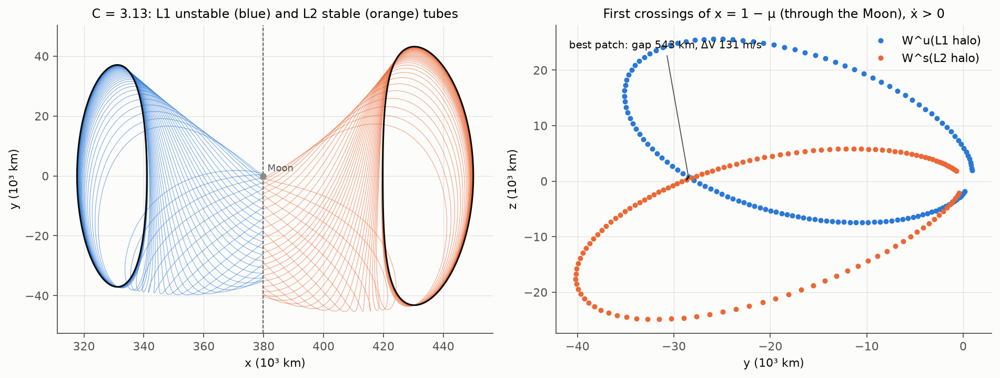
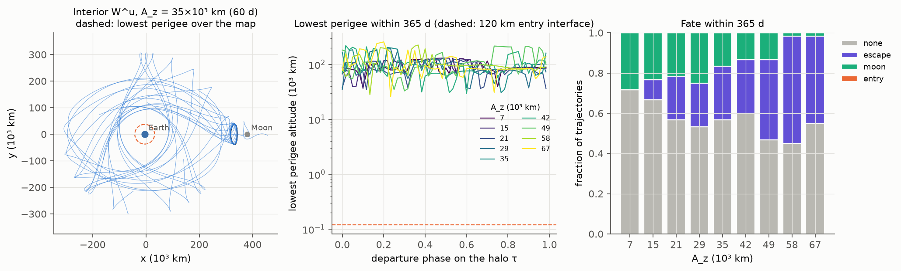
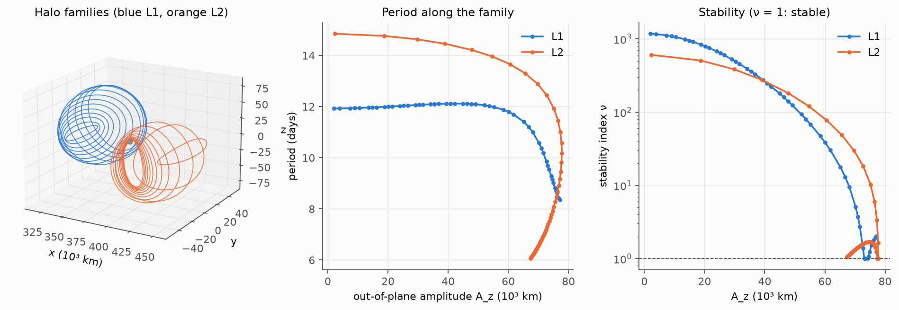
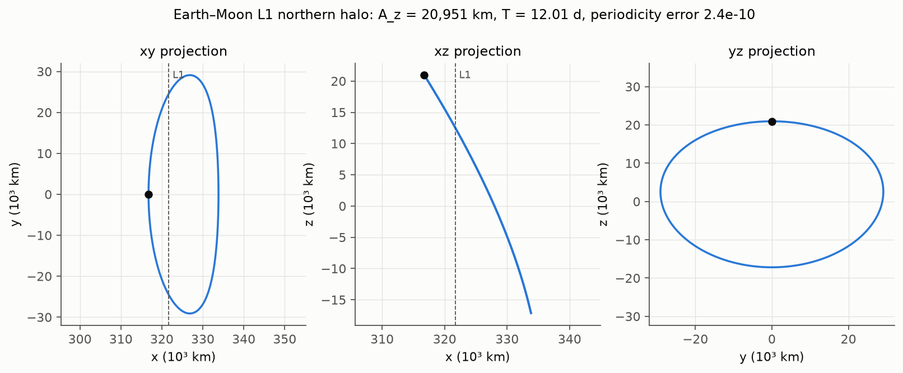
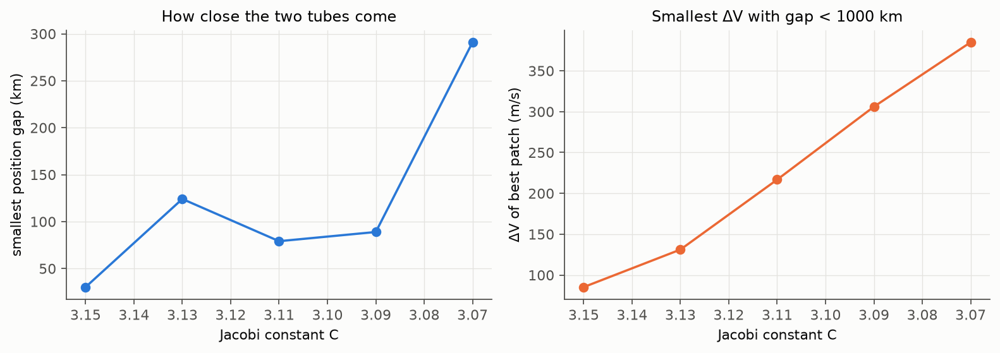

<div align="center">

# Earth–Moon Halo Orbits, Manifolds and L1 → L2 Connections

*Periodic orbits about the Earth–Moon L1 and L2 points, their invariant manifolds, energy-matched
patches through the lunar region, and where the Earth-bound manifold actually goes.*

[](LICENSE)


**Bishwaswarup Nayak** · Department of Physics, Indian Institute of Science, Bengaluru

</div>

---

## Results

All numbers below are written by [`scripts/make_figures.py`](scripts/make_figures.py) to
[`data/results.json`](data/results.json); nothing is typed in by hand.

| | |
|---|---|
| **Halo families** | 50 L1 and 50 L2 halos by pseudo-arclength continuation, A_z up to ~78 000 km; every member closes after one period to < 1 × 10⁻⁸ (non-dimensional, ≈ 4 m) |
| **Reference L1 halo** (A_z ≈ 21 000 km) | period 12.01 d, C = 3.1624, stability index 770; the Richardson guess lands 400 km from the corrected orbit and converges in 4 Newton steps |
| **L1 → L2 patches** (C = 3.07–3.15) | the two tubes cross the plane through the Moon within 30–290 km of each other, but there the velocities differ by 1.2–2.7 km/s. The cheapest patch within 1000 km costs **85 m/s at C = 3.15**, rising to 385 m/s at C = 3.07 |
| **Earth approach** (9 L1 halos × 60 trajectories × 365 d) | **0 of 540** trajectories of the interior unstable manifold reach the 120 km entry interface. The lowest perigee is 26 000 km altitude; up to 53 % of trajectories escape the Earth–Moon system and up to 28 % hit the Moon |

Two things follow. First, at matched energy the L1 and L2 halo tubes do not meet ballistically on their
first crossings: where they overlap in position they cross in different directions, so a connection
needs either a 100–400 m/s burn or later crossings. Second, the Earth-bound branch of an L1 halo's
unstable manifold is **not** a free return to Earth in the CR3BP: over a year it stays tens of thousands of
kilometres up. A real return needs a perigee-lowering burn or solar perturbations, which this model omits.

<p align="center"></p>

*Left: unstable manifold of an L1 halo (blue) and stable manifold of an L2 halo (orange) at the same Jacobi
constant C = 3.13, drawn to the plane x = 1 − μ through the Moon. Right: their first crossings of that
plane (moving in +x) and the cheapest patch.*

<p align="center"></p>

*Interior unstable manifold of L1 halos. Left: 60 days of trajectories from one halo; the dashed circle is
the lowest perigee found. Middle: lowest perigee altitude against departure phase for nine halos; the
dashed line is the 120 km entry interface. Right: what happens to each trajectory within a year.*

<p align="center"></p>

*L1 (blue) and L2 (orange) halo families: orbits, period and stability index against out-of-plane
amplitude. Both families reach the near-stable (ν ≈ 1) near-rectilinear end.*

<details>
<summary>More figures</summary>



Reference L1 halo in three projections.



Smallest position gap and cheapest patch against Jacobi constant.

</details>

---

## What changed in v2.0

Version 1.0 has been withdrawn. Its differential corrector integrated to a fixed time T/2 and zeroed
(v_x, v_z) without requiring the orbit to be back on the y = 0 plane, so its "halo orbits" did not close
(return error 0.3–0.4 non-dimensional, about 150 000 km), and small amplitudes collapsed to z₀ = 0. The
Richardson guess applied the in-plane frequency to the velocities twice and dropped the Δ term of the
amplitude constraint. The demo then matched the stable and unstable manifolds of the *same* orbit, which
finds the orbit's own self-intersections rather than a transfer. Everything downstream (tubes, Poincaré
section, ΔV budget) inherited these errors.

| v1.0 | v2.0 |
|---|---|
| fixed-time shooting, no y = 0 constraint | event-detected half-period crossing, Howell corrector with the crossing-time term |
| Richardson velocities × λ twice, no Δ term | full third-order Richardson guess (400 km from the converged orbit) |
| continuation residual without y = 0 | pseudo-arclength continuation in (x₀, z₀, ẏ₀) with the same constraint |
| W^u and W^s of one orbit matched | L1 and L2 orbits corrected to the same C, matched on x = 1 − μ |
| no orbit tests | 31 tests, including periodicity < 10⁻⁸ for every orbit |

The `paper/` directory still describes v1.0 and is being rewritten.

The Earth-approach map comes from the former `space_highway` repository, which is now archived. That
code's own halo solver did not converge, and its geographic latitude/longitude assumed an orientation of
the Earth–Moon frame that the CR3BP does not define; here entry points are given in the Earth–Moon frame
instead (see below).

---

## Method

**Dynamics.** Circular restricted three-body problem in the rotating frame, non-dimensional
(L* = 384 400 km, T* = 4.348 d, μ = 0.012150585609), integrated with SciPy's DOP853 at rtol = atol = 10⁻¹².

**Halo orbits.** A third-order Richardson (1980) solution gives the initial state at the perpendicular
xz-plane crossing. The corrector integrates state and STM to the next y = 0 crossing (event detection)
and drives v_x and v_z there to zero, correcting (x₀, ẏ₀) with z₀ fixed (Howell 1984):

```math
\delta\begin{pmatrix}\dot x\\ \dot z\end{pmatrix}_{T/2}
= \left[\Phi_{\{4,6\},\{1,5\}} - \frac{1}{\dot y}\begin{pmatrix}\ddot x\\ \ddot z\end{pmatrix}\Phi_{2,\{1,5\}}\right]
\begin{pmatrix}\delta x_0\\ \delta \dot y_0\end{pmatrix}
```

The family is traced by pseudo-arclength continuation in X = (x₀, z₀, ẏ₀) with the tangent taken from the
null space of that Jacobian. `correct_to_jacobi` adds C(X) = C* as a third equation to put an L1 and an L2
orbit on the same energy.

**Manifolds.** The unstable and stable eigenvectors of the monodromy matrix are carried around the orbit
with the STM; each sample point is perturbed by ε = 10⁻⁶ (≈ 380 m) along them.

**L1 → L2 patches.** The Moon-side branch of W^u(L1 halo) is integrated forward and of W^s(L2 halo)
backward to the plane x = 1 − μ, stopping at the first crossing and discarding trajectories that pass
within 100 km of the lunar surface. Among crossings with ẋ > 0 the pair with the smallest velocity jump
and a position gap below 1000 km is reported.

**Earth approach.** The interior branch of W^u is propagated for up to a year with events for the entry
interface (Earth radius + 120 km), lunar impact, escape (r > 3 from Earth) and every perigee. At the
interface the inertial speed and flight-path angle are computed with v_I = v_rot + ω × r. Latitude is
measured from the Earth–Moon orbital plane and longitude from the Earth–Moon line at t = 0; turning them
into geographic coordinates would need an ephemeris model and an epoch.

---

## Reproduce

```bash
git clone https://github.com/Bishwaswarup/cr3bp-manifoldtransfer.git
cd cr3bp-manifoldtransfer
python -m venv .venv && source .venv/bin/activate
pip install -r requirements.txt

pytest -q                                   # 31 tests, ~5 s
python scripts/make_figures.py              # all figures + data/results.json, ~3 min
python scripts/make_figures.py --quick      # coarser version, ~1 min
jupyter notebook notebooks/demo_earth_moon_transfer.ipynb
```

```python
from src.dynamics import MU_EARTH_MOON as mu
from src.orbits import richardson_guess, differential_correction, periodicity_error

state0, T_half = differential_correction(richardson_guess(0.05, "L1", mu)[0], mu=mu)
print(periodicity_error(state0, 2 * T_half, mu))   # ~2e-10
```

---

## Repository layout

```
src/
  dynamics.py      CR3BP equations of motion, STM, Jacobi constant, Lagrange points
  orbits.py        Richardson guess, Howell corrector, continuation, correction to a given C
  manifolds.py     monodromy matrix, eigenvectors, manifold tubes
  connections.py   energy-matched L1/L2 halo pairs, section crossings, best patch
  reentry.py       Earth-approach map: entry interface, perigees, lunar impact, escape
  poincare.py      section crossings of sampled trajectories
  transfer.py      two-body TLI estimate and low-thrust leg (experimental; not used for results)
  viz.py           legacy plotting helpers
scripts/
  make_figures.py  every figure in figures/ and every number in data/results.json
notebooks/         step-by-step walk-through
tests/             31 pytest tests (dynamics, orbits, connections, re-entry)
paper/             LaTeX draft (describes v1.0; being rewritten)
```

## Limitations

- CR3BP only: no solar gravity, lunar eccentricity or solar radiation pressure. The Sun in particular
  can lower perigees over months, so the Earth-approach result is specific to this model.
- Patches use first crossings of x = 1 − μ only, with 150 samples per tube; later crossings and finer
  sampling may find cheaper patches.
- The L2 family is followed only on its first monotonic stretch in C when matching energies.

## Citation

```bibtex
@software{nayak2026cr3bp,
  author = {Nayak, Bishwaswarup},
  title  = {Halo Orbits, Invariant Manifolds and L1/L2 Connections in the Earth--Moon CR3BP},
  year   = {2026},
  version = {2.0.0},
  url    = {https://github.com/Bishwaswarup/cr3bp-manifoldtransfer}
}
```

## References

- Richardson, D. L. (1980). Analytic construction of periodic orbits about the collinear points. *Celestial Mechanics* 22, 241–253.
- Howell, K. C. (1984). Three-dimensional, periodic, 'halo' orbits. *Celestial Mechanics* 32, 53–71.
- Koon, W. S., Lo, M. W., Marsden, J. E. & Ross, S. D. (2008). *Dynamical Systems, the Three-Body Problem and Space Mission Design*. Springer.
- Parker, J. S. & Anderson, R. L. (2014). *Low-Energy Lunar Trajectory Design*. JPL Deep-Space Communications and Navigation Series.

## License

MIT, see [LICENSE](LICENSE).
