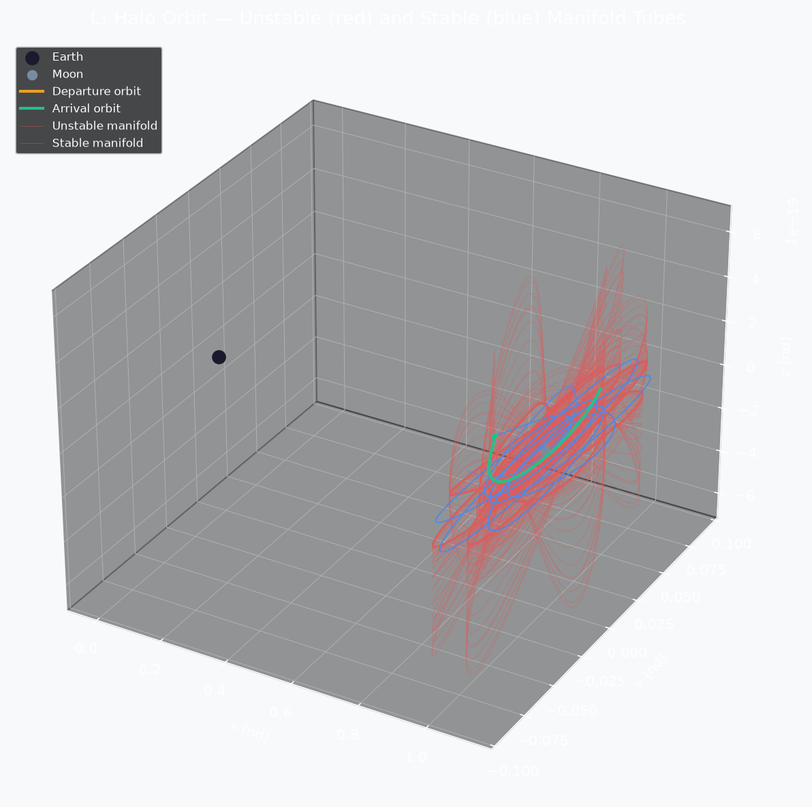

# CR3BP Manifold-Assisted Transfer Design

[](LICENSE)
[](https://www.python.org/)

Computes low-energy Earth–Moon transfers by matching invariant manifolds of
periodic orbit families (halo/Lyapunov) in the Circular Restricted Three-Body
Problem (CR3BP).

---

## What it does

- **Halo orbits**: generates the $L_1$ (or $L_2$) halo orbit family via
  - Third-order Richardson (1980) analytic initial guess
  - Single-shooting differential correction with STM
  - Pseudo-arclength continuation
- **Invariant manifolds**: computes stable/unstable manifold tubes from
  monodromy matrix eigenvector perturbation
- **Poincaré section**: detects manifold-tube crossings on the $y=0$ plane;
  finds near-intersections between departure (unstable) and arrival (stable) tubes
- **Transfer ΔV**: computes the stitching ΔV at the intersection + two-body TLI
  estimate from 200 km LEO
- **Low-thrust leg** *(optional)*: continuous tangential thrust arc from LEO to
  manifold insertion, targeted via a shooting method

---

## Example



*Stable (blue) and unstable (red) manifold tubes of an $L_1$ halo orbit in the
Earth–Moon rotating frame. The purple dashed line shows an optional low-thrust
arc from LEO.*

---

## Method

### CR3BP Equations of Motion

In the non-dimensional rotating frame (Earth at $-\mu$, Moon at $1-\mu$):

$$\ddot{x} - 2\dot{y} = \frac{\partial\Omega}{\partial x}, \quad
  \ddot{y} + 2\dot{x} = \frac{\partial\Omega}{\partial y}, \quad
  \ddot{z}             = \frac{\partial\Omega}{\partial z}$$

with $\Omega = \tfrac{1}{2}(x^2+y^2) + (1-\mu)/r_1 + \mu/r_2$.

The Jacobi constant $C = 2\Omega - v^2$ is the only integral of motion.

### Halo Orbits (Differential Correction)

Free variables: $(z_0,\,\dot{y}_0,\,T/2)$ at the $y=0$ xz-plane crossing.
Constraints: $\dot{x}(T/2) = \dot{z}(T/2) = 0$.
Jacobian from the state transition matrix $\Phi(T/2,0)$.

### Manifolds (Monodromy Eigenvectors)

Monodromy $M = \Phi(T,0)$. Eigenvectors of $M$ define stable ($\lambda < 1$)
and unstable ($\lambda > 1$) manifold directions. Perturb by $\varepsilon = 10^{-6}$
and integrate forward (unstable) or backward (stable).

### Poincaré Section & Intersection

Section: $y = 0$ plane. Crossings found by sign-change interpolation.
Best match minimizes position mismatch $(x_d-x_a)^2 + (z_d-z_a)^2$;
stitching $\Delta v = |\mathbf{v}_a - \mathbf{v}_d| \cdot V^*$ km/s.

For full mathematical details see [`paper/main.tex`](paper/main.tex).

---

## Usage

```bash
pip install -r requirements.txt
jupyter notebook notebooks/demo_earth_moon_transfer.ipynb
```

The notebook runs the full pipeline end-to-end:
1. Lagrange points
2. Halo orbit (Richardson guess → differential correction)
3. Monodromy matrix and manifold eigenvectors
4. Manifold tube computation
5. Poincaré section and intersection search
6. ΔV budget table
7. Halo family via pseudo-arclength continuation

To run the unit tests:

```bash
pytest tests/ -v
```

---

## Repository Structure

```
cr3bp-manifold-transfer/
├── src/
│   ├── dynamics.py     # CR3BP EOM, STM, Jacobi constant, Lagrange points
│   ├── orbits.py       # Richardson guess, differential correction, continuation
│   ├── manifolds.py    # Monodromy matrix, manifold tube generation
│   ├── poincare.py     # Section crossing detection, intersection search
│   ├── transfer.py     # ΔV stitching, TLI budget, low-thrust leg
│   └── viz.py          # 3D manifold plots, Poincaré plots, ΔV bar chart
├── notebooks/
│   └── demo_earth_moon_transfer.ipynb
├── paper/
│   ├── main.tex        # Journal-ready LaTeX paper
│   └── bibliography.bib
├── tests/
│   └── test_dynamics.py
├── figures/            # Saved output plots
├── data/
├── requirements.txt
├── LICENSE
└── README.md           ← you are here
```

---

## Requirements

```
numpy>=1.24
scipy>=1.10
matplotlib>=3.7
jupyter>=1.0
pytest>=7.0
```

Install: `pip install -r requirements.txt`

---

## Physical Constants (Earth–Moon)

| Quantity | Value |
|---|---|
| Mass parameter μ | 0.012150585609 |
| Length scale L* | 384 400 km |
| Time scale T* | 375 699.8 s ≈ 4.34 days |
| Velocity scale V* | 1.0232 km/s |

---

## Citation

If you use this code in published research, please cite:

```bibtex
@software{nayak2026cr3bp,
  author  = {Nayak, Bishwaswarup},
  title   = {CR3BP Manifold-Assisted Transfer Design},
  year    = {2026},
  url     = {https://github.com/Bishwaswarup/cr3bp-manifold-transfer}
}
```

*(A Zenodo DOI will be added here after the v1.0 release is archived.)*

---

## References

- Koon, Lo, Marsden & Ross (2008). *Dynamical Systems, the Three-Body Problem
  and Space Mission Design*. Springer.
- Richardson (1980). Analytic construction of periodic orbits about the
  collinear points. *Celestial Mechanics*, 22, 241–253.
- Howell (1984). Three-dimensional, periodic, 'halo' orbits. *Celestial
  Mechanics*, 32, 53–71.
- Parker & Anderson (2014). *Low-Energy Lunar Trajectory Design*. JPL.
- Folta et al. (2012). Applications of multi-body dynamical environments:
  the ARTEMIS transfer trajectory design. *Acta Astronautica*, 73, 237–249.

---

## License

MIT License — see [LICENSE](LICENSE).
